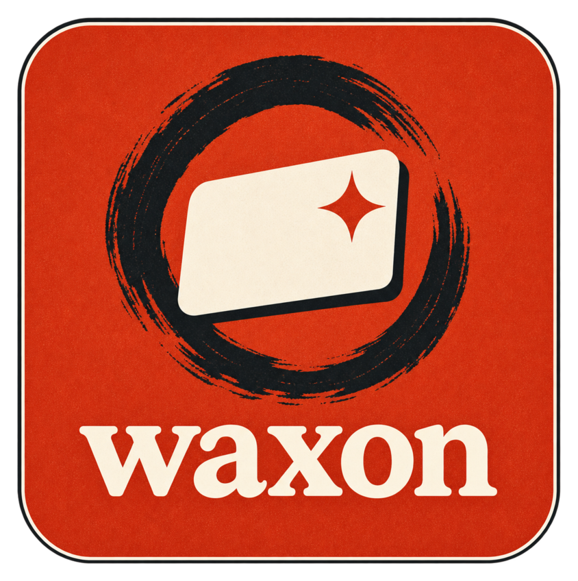

  
   
  <!-- repo-tagline:start -->
  <strong>🧠 Build knowledge and keep it 🔁</strong>
  <!-- repo-tagline:end -->

  
  

Waxon helps you remember what you study. Keep a private bank of questions and
answer from memory in your own words. Feedback and recall history determine
when each question comes up for review again.

## Try it

Open [Waxon](https://waxon.tsilva.eu), sign in, and add a question and answer
standard in **Library**. Open **Review** to answer due questions and read the
feedback. You can correct an evaluation from the review flow.

- [Local development](docs/local-development.md) covers installation,
  database setup, and checks. Existing legacy databases require the
  [separate reset procedure](docs/local-development.md#legacy-database-reset).
- [Agent access](docs/agent-access.md) covers searching and adding questions
  through MCP.
- [Question quality](reference/question-quality.md) explains how to write
  a question and answer standard.
- [Production delivery](docs/production-delivery.md) covers deployment.

## License

[MIT License](LICENSE).
